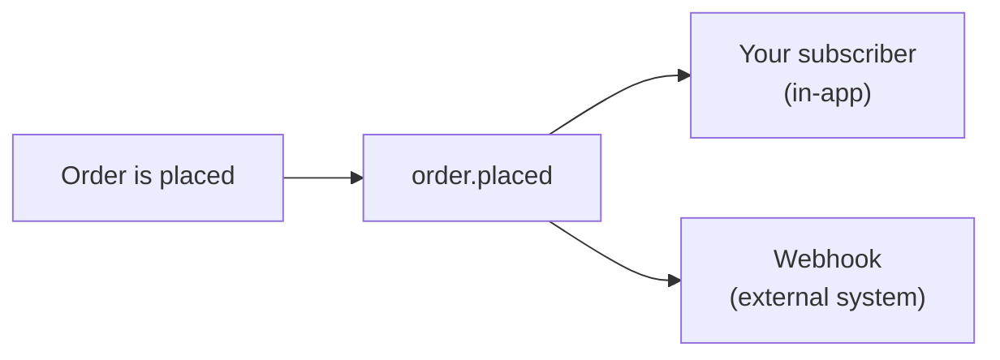

## Overview

Something happens in a store — an order is placed, a payment clears, a product sells out — and you want something else to happen: notify a warehouse, post to a channel, update a spreadsheet.

Events are how you attach that behaviour without editing Spree. Spree announces what happened; your code decides what to do about it.



There are two ways to listen, and which you want depends on where your code lives:

| | Use it when |
|---|---|
| **[Webhooks](/developer/core-concepts/webhooks)** | The thing reacting is a separate system — a Next.js app, an ERP, an automation tool |
| **Subscribers** | The reaction belongs inside the Spree application itself |

If you're building a headless storefront, **webhooks are almost certainly what you want**. Subscribers are for when you're running Spree as your own application and want to add behaviour to it.

## What Spree announces

Most records announce their own lifecycle:

| Event | When |
|---|---|
| `<resource>.created` | A record is created |
| `<resource>.updated` | It changes |
| `<resource>.deleted` | It's removed |

Those exist for orders, carts, products, variants, customers, payments, fulfillments, returns, media, price changes and more.

Adding a product to a category or collection, or taking it out, publishes `product_category.created` / `.deleted` and `product_collection.created` / `.deleted`.

On top of that, meaningful business moments get their own events:

| Event | Meaning |
|---|---|
| `order.placed` | An order was placed — one per order, so a checkout that split across several sellers publishes one per seller |
| `order_group.completed` | A checkout that split finished — one event for the whole purchase |
| `order.paid` | Payment is settled in full |
| `order.canceled` | The order was cancelled |
| `order.fulfilled` / `order.delivered` | Everything has shipped / arrived |
| `payment.completed` / `payment.voided` | A payment succeeded / was released |
| `fulfillment.fulfilled` / `fulfillment.canceled` | A parcel went out / was stood down |
| `product.out_of_stock` / `product.back_in_stock` | Availability flipped |
| `return.received` / `return.refunded` | A return arrived / was refunded |
| `import.completed` | An import finished |

For the full list of events and their payloads, see [Webhook Events & Payloads](/api-reference/webhooks-events).

The distinction matters when choosing what to listen for. `order.updated` fires whenever anything about an order changes — including an admin editing a note. `order.placed` fires once, when a customer actually bought something. Sending a confirmation email on the wrong one is how customers receive nine copies.

## What an event carries

An event carries the record it's about, serialized:

```json Event payload
{
  "id": "or_86Rf07xd4z",
  "number": "R123456789",
  "payment_status": "paid",
  "total": "135.60",
  "email": "customer@example.com"
}
```

IDs are the same prefixed IDs the API uses, so you can take an ID out of an event and fetch the full record without translating anything.

## Reacting in another system

Point a webhook at your endpoint and subscribe it to the events you care about. That's covered fully in [Webhooks](/developer/core-concepts/webhooks) — including signature verification, which you should not skip.

## Reacting inside Spree

A subscriber is a small class that names the events it wants and does something when one arrives.

<CodeGroup>

```bash Spree CLI (Docker)
spree generate subscriber OrderPlaced order.placed
```

```bash Without Spree CLI
bin/rails g spree:subscriber OrderPlaced order.placed
```

</CodeGroup>

The generator writes the class, a test, and — the step that's easy to forget — registers it.

```ruby server/app/subscribers/order_placed_subscriber.rb
class OrderPlacedSubscriber < Spree::Subscriber
  subscribes_to 'order.placed'

  def handle(event)
    order = Spree::Order.find_by_prefix_id(event.payload['id'])
    return unless order

    WarehouseClient.new.submit(order)
  end
end
```

A subscriber can listen to several events, or to a whole family:

```ruby server/app/subscribers/order_placed_subscriber.rb
subscribes_to 'order.placed', 'order.canceled'
subscribes_to 'order.*'
```

Subscribers must be registered — they aren't discovered automatically, because a subscriber that starts running because of where its file sits is hard to reason about:

```ruby server/config/initializers/spree.rb
Rails.application.config.after_initialize do
  Spree.subscribers << OrderPlacedSubscriber
end
```

### Subscribers run in the background

By default a subscriber runs as a background job, so a slow API call in your code doesn't slow down the customer's checkout — and a failure doesn't roll back their order.

That's almost always what you want. If you genuinely need to run inside the same transaction, you can ask to:

```ruby server/app/subscribers/order_placed_subscriber.rb
subscribes_to 'order.placed', async: false
```

<Warning>
A synchronous subscriber runs while the customer waits, so a slow one slows their checkout. An exception in it is reported to `Rails.error` and swallowed in production, but re-raised in development and test so you notice it. Reserve it for work that must happen immediately, and keep it fast.
</Warning>

## Publishing your own events

Anything in your own code can announce something, and subscribers and webhooks treat it like any built-in event. Declare the event on the model first, then publish it:

```ruby server/config/initializers/spree_events.rb
Rails.application.config.to_prepare do
  Spree::Order.publishes_event :flagged_for_review
end
```

```ruby server/app/services/fraud_check.rb
order.publish_event('order.flagged_for_review')
```

Useful when your own domain has moments worth reacting to — a fraud check completing, an approval granted.

Every event Spree publishes is declared this way, which is what lets the admin dashboard's webhook picker, the [webhook events endpoint](/developer/core-concepts/webhooks#event-subscriptions) and the typed events in `@spree/sdk/webhooks` list it. Publishing an event nobody declared raises an error in development and test, so a typo is caught before it ships; in production it is logged and delivered anyway.

The payload is the model's Store API serializer, as for built-in events. To send something else, pass a serializer of your own: `publishes_event :flagged_for_review, serializer: 'MyApp::FraudFlagEventSerializer'`. Keep it to what a customer could see; back-office fields belong behind the Admin API. Facts about the event rather than the record, such as who triggered it, go in its metadata: `order.publish_event('order.flagged_for_review', nil, rule: 'velocity')`.

## Delivery guarantees

Spree hands an event to its subscribers in the process that published it. Events are not saved first and sent later. A background subscriber, and every webhook, then runs as a background job.

For `order.placed`, this means:

- **It is published once per order**, by the completion that placed it — at checkout, or when a draft order is completed in the dashboard.
- **At checkout, it is published after the order is saved.** The database transaction that places the order has committed before the event goes out, so nothing hears about an order that was then rolled back.
- **A repeated completion doesn't publish it again.** A double-clicked Place Order or a retried request finds the order already placed and returns it without publishing.
- **It can be missed.** If the process stops after the order is saved but before the event is published — a crash, a deploy, a stopped container — the order stays placed and no `order.placed` is ever published for it.
- **Failures after publishing are retried.** A background subscriber that raises an error runs again, up to 3 attempts in all. A webhook delivery that fails is sent again, up to 5 attempts. A synchronous subscriber is not retried.

So when a side effect must happen for every placed order — sending it to an ERP or a warehouse, for example — don't rely on the event alone:

1. **Make the handler safe to run twice.** Key the work on the order's ID. Checking whether you already did it and then doing it is not enough on its own: a webhook and a reconciliation run can both pass the check at the same time, and a crash after the write repeats it on retry. Pass the order's ID as an idempotency key to the external system, so it ignores a second write for the same order. If the external system can't take a key, claim the order atomically (for example, an insert guarded by a unique constraint) and record completion separately from the claim, so a run that finds a claim without a completion knows the write may not have happened and finishes it.
2. **Reconcile from orders.** On a schedule, list the orders placed since your last check and handle any you haven't seen. The event gives you speed; the reconciliation makes sure nothing is lost.

<Tabs>
  <Tab title="Admin SDK">
    ```typescript
    // Capture the next checkpoint before reading, not after.
    const runStartedAt = new Date()
    const since = new Date(lastCheckedAt.getTime() - 5 * 60 * 1000) // overlap the previous run

    let page: number | null = 1
    while (page) {
      const { data: orders, meta } = await adminClient.orders.list({
        completed_at_gteq: since.toISOString(),
        completed_at_lteq: runStartedAt.toISOString(), // orders after this belong to the next run
        sort: 'completed_at',
        limit: 100,
        page,
      })

      for (const order of orders) {
        // Idempotent on order.id: the ERP rejects a second sales order with the same key.
        await syncToErp(order, { idempotencyKey: order.id })
      }

      page = meta.next
    }

    // Only after every page succeeded.
    await saveCheckpoint(runStartedAt)
    ```
  </Tab>
  <Tab title="cURL">
    ```bash
    curl -G 'https://store.example.com/api/v3/admin/orders' \
      -H 'X-Spree-API-Key: sk_xxx' \
      -d 'q[completed_at_gteq]=2026-11-12T09:00:00Z' \
      -d 'q[completed_at_lteq]=2026-11-12T10:00:00Z' \
      -d 'sort=completed_at' \
      -d 'limit=100' \
      -d 'page=1' # repeat with meta.next until it is null
    ```
  </Tab>
</Tabs>

Take the next checkpoint from the moment the run started, before reading, and save it only after every page succeeded. Start each run a few minutes before the saved checkpoint: an order's `completed_at` is set before its transaction commits, so an order can become visible after a run that started later has already read past it. The overlap is safe as long as no order takes longer than that to commit; the idempotent handler makes the overlap harmless.

## Guidance

**Listen for the specific event.** `order.placed` rather than `order.updated` with a status check.

**Assume events can arrive more than once.** A retry after a network blip can redeliver. Make handlers safe to run twice: pass the event's or record's ID as an idempotency key to whatever you call, rather than checking whether you've already acted and then acting, which two deliveries can both pass at once. See [Delivery guarantees](#delivery-guarantees).

**Don't chain long sequences of subscribers.** When one event triggers a subscriber that triggers another, working out what happened after the fact becomes archaeology. Prefer one handler that does the sequence.

**Keep failures contained.** A subscriber that raises shouldn't take down anything else. Handle your own errors and log them.

## Related

- [Webhooks](/developer/core-concepts/webhooks) — reacting from outside Spree
- [Orders](/developer/core-concepts/orders) — the order lifecycle these events describe
- [Imports & Exports](/developer/core-concepts/imports-exports) — completion events for bulk work
