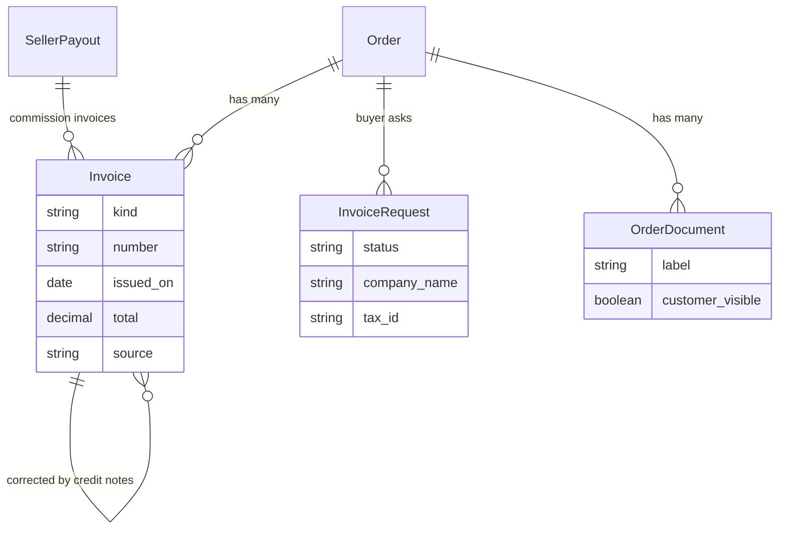

## Overview

An order produces paperwork. In much of the world, Europe especially, the most important piece is the **invoice**: a legal document issued by whoever sold the goods, which the buyer needs for their accounts and the seller must keep for years. Spree keeps two kinds of records for this:

| Record | What it is | Who can see it |
|---|---|---|
| **Invoice** (`Spree::Invoice`) | An invoice, receipt or credit note, with its number, totals and PDF | The buyer, staff and, on a marketplace, the seller |
| **Order document** (`Spree::OrderDocument`) | Any other file on an order: the buyer's purchase order, a specification, a shipping document | Staff and sellers; the buyer only when it is made visible, or when they uploaded it themselves |

Open-source Spree **holds and delivers** invoices: your ERP, accounting tool, national e-invoicing platform or a marketplace seller's own software issues them, and you upload the PDF with its number. Spree stores it privately, shows it on the order, emails it to the buyer, and lets buyers request one. Generating invoices inside Spree is part of Spree Enterprise, and writes the same records.



## Who issues an invoice

An invoice is issued by whoever sold the goods. Spree works out the **issuer** from the order:

- a first-party order is invoiced by the **store**;
- a marketplace seller's order is invoiced by the **seller**, who is the merchant of record for it;
- a seller whose sales tax the marketplace collects (`tax_remittance: platform`) is invoiced for by the **store**.

A marketplace checkout split across three sellers produces three seller orders, so the buyer gets three invoices, one from each seller.

A **commission invoice** is the marketplace's invoice to a seller for its commission. It belongs to a seller payout, and the store is its issuer.

## Kinds and corrections

| Kind | Used for |
|---|---|
| `invoice` | A tax invoice, usually for a business buyer |
| `receipt` | A sales receipt for a private buyer |
| `credit_note` | A correction of an earlier invoice or receipt, with negative totals |

Invoices are legal records, so **an invoice never changes once it exists**: its number, totals and file are fixed. A mistaken upload can be deleted only until the buyer has been sent it. After that, correct it by uploading a credit note that points at the original through `original_invoice_id`.

Numbers belong to the issuer: an uploaded invoice keeps the number its issuing system gave it, unique per issuer and kind. Spree's order numbers are never invoice numbers.

## Uploading an invoice

Upload the PDF privately first, then record the invoice on the order.

<Tabs>
  <Tab title="Admin SDK">
    ```typescript
    const upload = await client.files.upload(file, { visibility: 'private' })

    const invoice = await client.orders.invoices.create('or_xxx', {
      kind: 'invoice',
      number: 'FV/2026/11/42',
      issued_on: '2026-11-01',
      total: '123.00',
      net_total: '100.00',
      tax_total: '23.00',
      file_signed_id: upload.signed_id,
    })
    ```
  </Tab>
  <Tab title="cURL">
    ```bash
    curl -X POST https://your-store.com/api/v3/admin/orders/or_xxx/invoices \
      -H "Authorization: Bearer $SECRET_KEY" \
      -H "Content-Type: application/json" \
      -d '{"kind":"invoice","number":"FV/2026/11/42","issued_on":"2026-11-01","total":"123.00","file_signed_id":"eyJfcmFpbHMi..."}'
    ```
  </Tab>
</Tabs>

A marketplace seller uploads to their own orders through the Seller API (`client.orders.invoices.create` in `@spree/seller-sdk`). Commission invoices are uploaded to the payout: `client.sellerPayouts.invoices.create`.

## Connecting your invoicing system

An external system issues invoices from the events Spree already publishes, then uploads the result:

| Event | What to do |
|---|---|
| `order.paid` | Issue the invoice or receipt for the order |
| `refund.created` | Issue a credit note against the order's invoice |
| `order.invoice_requested` | Issue an invoice for a buyer who asked for one; the payload carries their company name and tax number |
| `invoice.created` | An invoice was added, uploaded or generated |

Subscribe a [webhook endpoint](/developer/core-concepts/webhooks) to these events and upload with the Admin API. To find gaps, list orders with the `missing_invoice` filter: placed and paid orders with no invoice or receipt yet.

## Invoice requests

A private buyer can ask for an invoice on their order, adding a company name and tax number if they have one. This is required in some countries, such as Poland, where a consumer may ask for an invoice up to three months after the purchase.

<CodeGroup>

```typescript Store SDK
const invoiceRequest = await client.orders.invoiceRequests.create(
  'or_xxx',
  { company_name: 'Acme GmbH', tax_id: 'DE123456789' },
  { token: '<order token>' },
)
```

</CodeGroup>

A request is accepted while the order has no invoice and within the store's request window (`invoice_request_window_days`, 90 days by default; 0 turns requests off). It stays open until an invoice of kind `invoice` is added to the order, which fulfils it.

## Delivering invoices to the buyer

When an invoice is added and the store's `send_invoice_email` setting is on, the buyer is emailed the PDF. Turn it off when your own system already emails invoices. Staff and sellers can always send an invoice again with `POST /invoices/:id/resend`.

Buyers list their invoices with `client.orders.invoices.list` and download each one from its `download_url`. Files are streamed through the API, never linked to storage, so only the order's owner can fetch them.

## Order documents

Order documents hold the rest of an order's paperwork. Staff and sellers upload them with `client.orders.documents.create` and choose with `customer_visible` whether the buyer sees each one. A buyer can add their own documents from their account, such as their purchase order; those are always visible to them and marked as theirs.

## Privacy and retention

Tax law requires keeping invoices for five to ten years, depending on the country, so erasing a customer's personal data leaves their invoices in place. It removes the documents the buyer uploaded, and clears the company name and tax number from their invoice requests.

## Related

- [Orders](/developer/core-concepts/orders)
- [Commissions](/developer/core-concepts/commissions)
- [Webhooks](/developer/core-concepts/webhooks)
- [Email variables](/developer/customization/email-variables)
