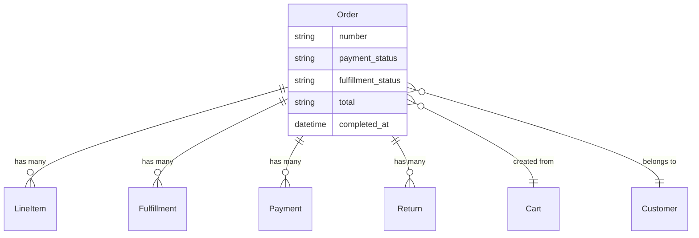

## Overview

An order is a placed purchase. It's created by completing a [Cart](/developer/core-concepts/carts) and holds its own copy of everything the customer agreed to — items, prices, taxes, discounts and delivery. Anything your storefront stored in the cart's `metadata` is copied onto the order too, including onto every order of a checkout split between sellers.



## Order attributes

| Attribute | Description |
|---|---|
| `id` | Order ID, e.g. `or_86Rf07xd4z` |
| `number` | Order number shown to customers, e.g. `R1001` — sequential by default, [customizable](/developer/how-to/custom-document-numbers) |
| `cart_id` | The cart this order came from |
| `email` | Customer's email address |
| `currency` | Order currency, e.g. `USD` |
| `total_quantity` | Total number of items |
| `payment_status` | See [statuses](#statuses) below |
| `fulfillment_status` | See [statuses](#statuses) below |
| `item_total` / `display_item_total` | Sum of line item prices |
| `delivery_total` / `display_delivery_total` | Delivery cost |
| `tax_total` / `display_tax_total` | Total tax |
| `discount_total` / `display_discount_total` | Total discount |
| `total` / `display_total` | Order total |
| `amount_due` / `display_amount_due` | Still outstanding |
| `completed_at` | When the order was placed |

Every amount comes in two forms: `total` is the raw value (`"135.60"`) and [`display_total` is formatted for the currency](/api-reference/store-api/monetary-amounts) (`"$135.60"`). Render the `display_` one.

## Statuses

An order tracks payment and delivery separately, because they genuinely move at different speeds. An order can be paid but not yet sent, or sent and later partly refunded.

**`payment_status`**

| Value | Meaning |
|---|---|
| `none` | Nothing paid or authorized yet |
| `authorized` | Money is held but not taken |
| `partially_paid` | Some of the total has been taken |
| `paid` | Fully paid |
| `partially_refunded` | Some money returned |
| `refunded` | Everything returned |
| `overcharged` | More was taken than the order total |
| `voided` | The hold was released without taking money |

**`fulfillment_status`**

| Value | Meaning |
|---|---|
| `unfulfilled` | Nothing has gone out yet |
| `backorder` | Waiting on stock |
| `partial` | Some of it has gone out |
| `fulfilled` | Everything has gone out |
| `delivered` | The customer has all of it |
| `canceled` | Nothing will be sent |

A canceled parcel is ignored while others are still live, so an order whose
second parcel was recalled is described by the first.

`delivered` means every parcel arrived. A fulfillment that travels as several
consignments — a machine in three boxes, a pallet under one freight number —
is only delivered when the last of them lands, and the order follows from
there. See [where the parcel actually
is](/developer/core-concepts/fulfillments#where-the-parcel-actually-is).

Both are worked out automatically from the order's payments, refunds and fulfillments. You change an order's status by acting on those — taking a payment, sending a parcel, issuing a refund — never by setting the status yourself.

## Reading an order

A customer can fetch their own order; guests use the order token they got at checkout.

<CodeGroup>

```typescript Store SDK
// A single order
const order = await client.orders.get('or_xxx')

// The signed-in customer's order history
const orders = await client.customers.orders.list({ per_page: 20 })
```

```bash cURL
curl 'https://api.mystore.com/api/v3/store/orders/or_xxx' \
  -H 'X-Spree-API-Key: pk_xxx' \
  -H 'X-Spree-Token: order_token_xxx'
```

</CodeGroup>

## Managing orders

Back-office work happens through the Admin API.

<CodeGroup>

```typescript Admin SDK
// Find orders needing attention
const orders = await adminClient.orders.list({
  payment_status_eq: 'paid',
  fulfillment_status_eq: 'unfulfilled',
})

// Cancel an order, recording why from your own list of reasons
const [reason] = (await adminClient.orderCancellationReasons.list()).data
await adminClient.orders.cancel('or_xxx', {
  cancel_reason_id: reason.id,
  cancel_note: 'Supplier could not deliver in time',
})

// On a split checkout the payment is shared, so refund_payments decides
// whether this order's share of it comes back
await adminClient.orders.cancel('or_grouped_xxx', {
  cancel_reason_id: reason.id,
  refund_payments: true,
})

// On a split checkout the payment is shared, so this gives back only this
// order's share — all of it, or the part named by refund_amount
await adminClient.orders.cancel('or_grouped_xxx', {
  cancel_reason_id: reason.id,
  refund_payments: true,
  refund_amount: '25.00',
})

// Take an authorized payment
await adminClient.orders.payments.capture('or_xxx', 'py_xxx')

// Refund against a specific payment
await adminClient.orders.refunds.create('or_xxx', {
  payment_id: 'py_xxx',
  amount: '25.00',
})
```

```bash cURL
curl 'https://api.mystore.com/api/v3/admin/orders?filter[payment_status_eq]=paid' \
  -H 'X-Spree-API-Key: sk_xxx'

curl -X PATCH 'https://api.mystore.com/api/v3/admin/orders/or_xxx/cancel' \
  -H 'X-Spree-API-Key: sk_xxx' \
  -H 'Content-Type: application/json' \
  -d '{ "cancel_reason_id": "ocr_xxx", "refund_payments": true }'
```

</CodeGroup>

Canceling always puts stock back — the goods are not going out either way — and
every payment is settled at the gateway. What that means is the gateway's
decision: an authorization it never drew on is released, and a captured charge
it cannot release is refunded instead.

On a split checkout one payment is shared across several orders, so what comes
back is this order's own share, drawn from each payment in turn until it is met.
`refund_amount` names part of that share to return, keeping a restocking fee
back, say. It is refused on an ordinary order rather than ignored: the gateway
returns the whole captured payment there, so a cap could not be honoured, and
accepting one would refund everything while you believed part was held back.

It records who canceled, and optionally why: the reason comes from a list you
manage yourself under Settings, so it can say what your team actually means. A
staff-facing note can go alongside it.

## Orders don't change quietly

A placed order is meant to stay put. Its items and prices are written when the cart is completed and then left alone, so an order keeps saying what the customer actually agreed to — even if a product's price changes the next day.

Where admin edits are allowed, totals are re-added from the order's existing rows rather than worked out again from scratch. Editing an order must never quietly re-apply today's promotions and hand the customer a different discount than the one they accepted.

## Editing a placed order

Changes to a placed order's items go through an **order change**: a set of
actions — add a product, change a quantity, remove a line — that is previewed
first and then applied in one go. Either every action applies or none does, and
each applied change stays on the order as a record of who changed what, and
when.

Preview a change to see what it does to the totals before anything is saved,
then create it with `confirm: true` to apply it. This is what the admin
dashboard's **Edit order** screen does on a placed order.

<Tabs>
  <Tab title="Admin SDK">
    ```typescript
    const actions = [
      { kind: 'update_item', line_item_id: 'li_xxx', quantity: 3 },
      { kind: 'add_item', variant_id: 'variant_xxx', quantity: 1 },
    ]

    // What the order would look like — nothing is saved
    const preview = await adminClient.orders.orderChanges.preview('or_xxx', { actions })
    preview.total               // the new order total
    preview.balance_delta       // how far the total moves
    preview.outstanding_balance // what the customer owes after it; negative when they are owed money back

    // Apply it
    await adminClient.orders.orderChanges.create('or_xxx', { actions, confirm: true })

    // Every change made to the order
    const changes = await adminClient.orders.orderChanges.list('or_xxx')
    ```
  </Tab>
  <Tab title="cURL">
    ```bash
    curl -X POST 'https://api.mystore.com/api/v3/admin/orders/or_xxx/order_changes/preview' \
      -H 'X-Spree-API-Key: sk_xxx' \
      -H 'Content-Type: application/json' \
      -d '{ "actions": [{ "kind": "update_item", "line_item_id": "li_xxx", "quantity": 3 }] }'

    curl -X POST 'https://api.mystore.com/api/v3/admin/orders/or_xxx/order_changes' \
      -H 'X-Spree-API-Key: sk_xxx' \
      -H 'Content-Type: application/json' \
      -d '{ "confirm": true, "actions": [{ "kind": "update_item", "line_item_id": "li_xxx", "quantity": 3 }] }'
    ```
  </Tab>
</Tabs>

A few rules to know:

- **No money moves on its own.** Applying a change updates the order's totals
  and its payment status — `partially_paid` when the customer owes more,
  `overcharged` when they are owed some back. You collect or refund the
  difference from the order's payments, as after any other edit.
- **One change at a time.** Created without `confirm`, a change waits as
  `requested` until it is confirmed or canceled, and the order takes no other
  change in the meantime.
- **Stock is taken when the change is applied**, not while it waits. An added
  product that sold out in between makes the change fail, with nothing applied.
- **A line keeps the price it was sold at.** Changing a quantity never re-prices
  the line.
- **Drafts are edited directly** through the order. Order changes are for placed
  orders only.

Returns, exchanges and claims use the same mechanism: receiving goods back and
shipping replacements each leave an order change on the order, linked to the
return, exchange or claim that made it.

To refuse some edits — after a cut-off time, or for products that cannot be
added after placement — register a handler on the `order_changes.add_action.validate`
hook. `order_changes.confirm.before_confirm` runs once a change is applied but
before it is committed, and can still refuse it (see [Workflows](/developer/customization/workflows)).
To settle the balance automatically — charging or refunding at your payment
provider — subscribe to the `order_change.confirmed` [event](/developer/core-concepts/events),
which is sent once the change is saved, rather than doing it in a hook: a
return or claim can apply its change inside a larger step that may still fail.

```ruby config/initializers/spree.rb
Spree.hooks.register('order_changes.add_action.validate') do |workflow|
  if workflow.kind == 'add_item' && workflow.order_change.order.completed_at < 1.day.ago
    workflow.reject!('Orders can only gain items on the day they were placed')
  end
end
```

## Money on an order

Tax, discounts and fees are kept as separate records, so you can ask what tax was charged without picking through a mixed list. See [Order totals](/developer/core-concepts/order-totals).

## Events

Orders publish [events](/developer/core-concepts/events) — `order.placed`, `order.canceled`, `order.paid` and more — which also reach [webhooks](/developer/core-concepts/webhooks). This is the right way to push orders to another system, trigger fulfillment, or start an email flow.

## Related

- [Carts](/developer/core-concepts/carts) — shopping and checkout
- [Fulfillments](/developer/core-concepts/fulfillments) — getting items to the customer
- [Returns, Exchanges & Claims](/developer/core-concepts/returns-exchanges-claims) — after the sale
- [Payments](/developer/core-concepts/payments) — payment methods and processing
