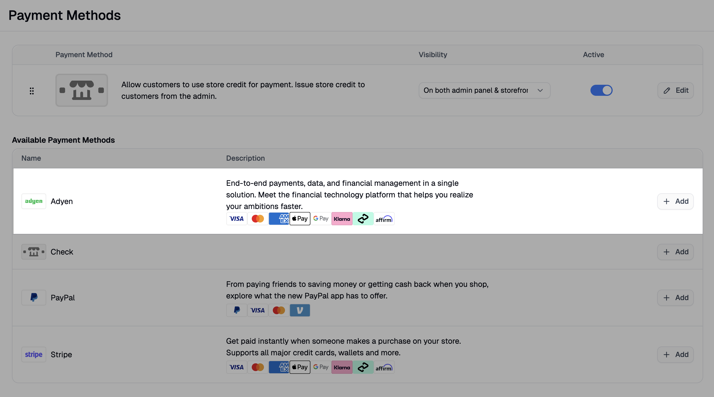

Adyen is a global payment platform. Spree's Adyen integration takes payments through Adyen's Sessions flow and its Drop-in component, so your shoppers see every payment method you enable in Adyen that pays a checkout in one payment: cards, Apple Pay and Google Pay, buy now pay later methods such as Klarna, bank and local methods such as iDEAL, BLIK and Bancontact.

## Installation

The integration ships with Spree as the `spree_adyen` gem and needs Ruby 3.3 or newer.

<CodeGroup>

```bash Spree CLI (Docker)
spree add adyen
```

```ruby Without Spree CLI
# server/Gemfile — use the same version requirement as your `spree` gem, then run `bundle install`
gem 'spree_adyen', '>= 6.0.0'
```

</CodeGroup>

The Spree CLI restarts the server for you. Without it, restart the server yourself. The gateway registers itself, so there is nothing to generate and no migrations to run.

## Set up Adyen

### 1. Create an API credential

In the [Adyen Customer Area](https://ca-live.adyen.com/), select the merchant account you take payments with, then go to **Developers → API credentials** and create a **Web service user** credential. Under **Server settings**, generate an **API key** and copy it: Adyen shows it only once.

Give the credential these roles, under **Roles**:

- **Checkout webservice role**, to take payments
- **Management API — API credentials read and write**, so Spree can generate the client key and add your storefront's allowed origins
- **Management API — Webhooks read and write**, so Spree can set up its webhook
- **Management API — Accounts read**, so Spree can check the credential reaches your merchant account

Spree generates the client key and adds the allowed origins itself, so you do not need to under **Client settings**. A company-level credential can serve several stores and merchant accounts; each payment method in Spree names its own merchant account.

### 2. Turn on Additional data

Spree records the card brand, last four digits, expiry and saved-card token Adyen reports. Adyen sends them only when asked:

- In **Developers → Additional data**, turn on **Card summary**, **Expiry date** and **Recurring contract information** (the saved card's token). Leave the two deprecated recurring contract settings off.
- In **Developers → Webhooks**, after Spree has created its webhook (step 4), click the pencil icon next to it to edit it. Under **Additional settings → Card**, turn on **Include card info for recurring contract events** (the last four digits and expiry), then save the configuration. This covers payments Spree records from Adyen's webhook, when the shopper does not return to the storefront after paying. The **Webhooks settings** page lists extra event codes Spree does not use; leave it as it is.

### 3. Leave Adyen's capture delay at immediate

Spree decides when money is taken (see [Capturing payments](#capturing-payments)). Leave **Capture delay**, under **Settings → Merchant account settings**, at **Immediate**, its default. With a delay there, Spree records as captured at checkout money Adyen takes days later.

### 4. Add the payment method in Spree

In the Spree admin go to **Settings → Payments**, find Adyen under **Payment providers** and click **Connect**. Fill in:

- **API key** — from step 1
- **Merchant account** — the merchant account's name, exactly as Adyen shows it
- **Test mode** — on for test credentials, off for live
- **Live URL prefix** — live only: **Developers → API URLs → Prefix** in the Customer Area

When you save, Spree checks that the API key reaches the merchant account and has the roles above, and names what is missing if it does not. It then configures Adyen in the background:

- keeps the credential's client key, or generates one if it has none (an existing key is never replaced, so other stores sharing the credential keep working);
- adds your store's allowed origins to the credential, so Drop-in loads on your storefront;
- creates a webhook for this payment method on your Spree store's URL, with an HMAC key Spree keeps, and verifies every delivery with it.

It does this again whenever you change the API key, merchant account, test mode or live URL prefix. Allowed origins you add to the store later reach Adyen the next time you save the payment method.

<Warning>Your Spree store must be reachable from the internet for Adyen to deliver webhooks. Use a tunnel (for example ngrok) when testing locally.</Warning>



## Capturing payments

Adyen follows the capture setting of the payment method, or the store's when the method has none:

- **At checkout**: Adyen takes the money when the shopper pays.
- **On dispatch** or **Manually**: Adyen authorises the payment at checkout, and Spree captures it when the order is dispatched or when staff capture it from the dashboard.

Adyen holds Klarna, Riverty and Affirm payments for a capture request whatever its own capture delay says. With capture **At checkout**, Spree records them as authorised and asks Adyen to capture them as soon as the order is placed; the payment shows **Capture requested** until Adyen confirms. Leave these methods on manual capture in Adyen, as they come: if Adyen Support turns on automatic capture for one, Adyen takes the money itself, refuses Spree's capture request, and the payment shows as failed in Spree although it was paid.

Some methods cannot be captured later, iDEAL and BLIK among them: Adyen takes the money at once whatever the setting, and Spree records those payments as paid. Adyen expires card authorisations after 28 days, and schemes may do so sooner; a capture after that fails with Adyen's reason.

## The storefront

The Next.js storefront renders Adyen's Drop-in and needs no Adyen keys of its own: each payment session carries the client key and environment. `NEXT_PUBLIC_ADYEN_CLIENT_KEY` and `NEXT_PUBLIC_ADYEN_ENVIRONMENT` are read only as fallbacks for older backends.

- **Return URLs.** A payment method that redirects the shopper (a bank, a 3D Secure check) returns them to the URL the storefront sends, which must be on one of your store's allowed origins. A native app returns through a universal or app link on an allowed origin, never a custom URL scheme.
- **Apple Pay.** Apple Pay needs Adyen's domain association file at `/.well-known/apple-developer-merchantid-domain-association` on every storefront domain. Download it from Adyen and host it in your storefront, then register the domains with Adyen as its Apple Pay guide describes.
- **Google Pay.** Register your storefront domains in the Google Pay & Wallet Console.
- **Paying a session.** A session opens unpayable. When the shopper presses Pay, Drop-in asks Spree to make it payable at the amount Spree holds, and only then pays it. A method that skips that step fails instead of slipping past Spree.

If you build your own storefront, follow the same flow with the Store API's payment sessions: create a session with a `return_url`, mount Drop-in with the `session_data`, `client_key` and `environment` from its `external_data`, update the session with `external_data.submit` in Drop-in's `beforeSubmit` and resolve with the `session_data` it returns, then complete it with Drop-in's `sessionResult` or the redirect's `redirectResult`.

## Saved cards

A signed-in shopper sees a **Save for my next payment** checkbox on card payments. Cards are saved only when they tick it, and are offered again inside Drop-in at their next checkout. Guests' cards are never saved. Cards saved under the 5.x integration keep showing.

A shopper can also save a card without buying anything, from their account, through a payment setup session. Spree saves the card from the token Adyen returns with the session's result.

## What to watch for

- **Captures, voids and refunds wait for Adyen.** Adyen accepts each request and reports its outcome by webhook, usually within seconds. Until then the dashboard shows **Capture requested**, **Void requested** or a requested refund, and the payment takes no other action. If one waits long, check it in Adyen: Adyen retries an undelivered webhook for up to 30 days.
- **A failure can come later.** Adyen can report a capture or refund as failed after accepting it, sometimes days later. Spree then marks it failed, with Adyen's reason, and takes the money back out of the order's totals.
- **Methods Adyen captures at once** read as paid even when the store captures on dispatch.
- **Capture on dispatch takes the first parcel only.** Adyen cancels what a partial capture leaves, so later parcels of the same order find nothing left to capture. Take payment for multi-parcel orders at checkout, or capture them in full.
- **A session canceled after the shopper pressed Pay** stays payable at Adyen until it expires, an hour after it opened. If the shopper pays it, for example by retrying a card in a tab left open, the order shows more paid than owed; refund the difference.
- **A pending payment Adyen later refuses** stays pending in Spree. You see the refusal in Adyen.
- **Actions in Adyen's Customer Area** (captures, cancels, refunds made there) are not synced to Spree.

## Testing

Turn on **Test mode**, use test credentials from Adyen's test Customer Area, and pay with Adyen's [test card numbers](https://docs.adyen.com/development-resources/testing/test-card-numbers/), for example Visa `4111 1111 1111 1111` with CVC `737` and any future expiry. Test transactions appear in the test Customer Area under **Transactions**.

### Common issues

- **Drop-in does not load**: the storefront's origin is not among the credential's allowed origins. Add it to the store's allowed origins in Spree and save the payment method again.
- **Saving the payment method fails**: the message names the problem: an invalid key, a merchant account the credential cannot reach, or a missing role.
- **Webhooks are refused**: Spree checks every delivery's HMAC signature, merchant account and environment. A webhook you created by hand is not signed with the key Spree holds; let Spree manage its own.
