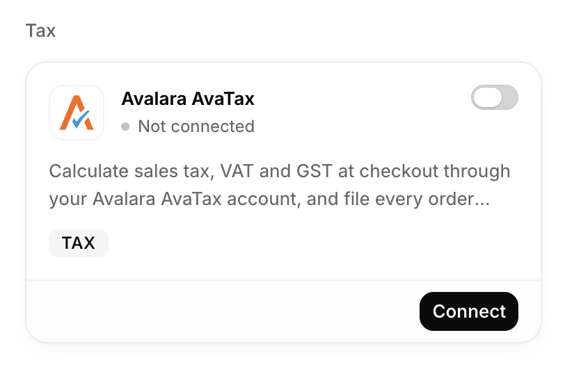
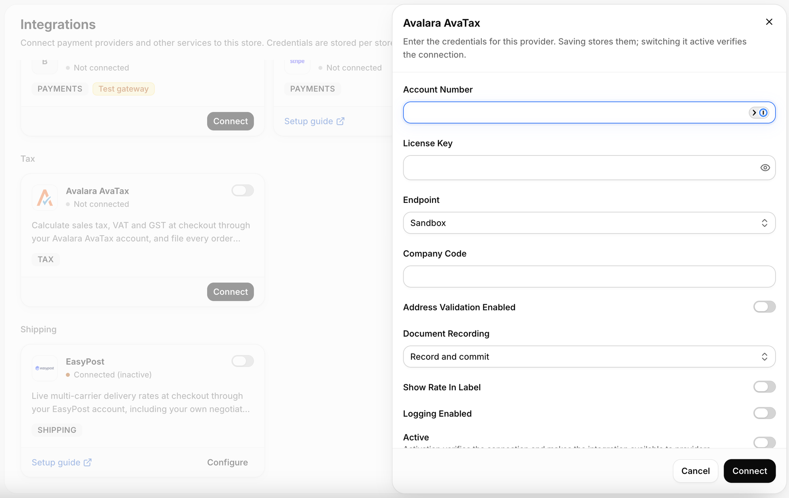
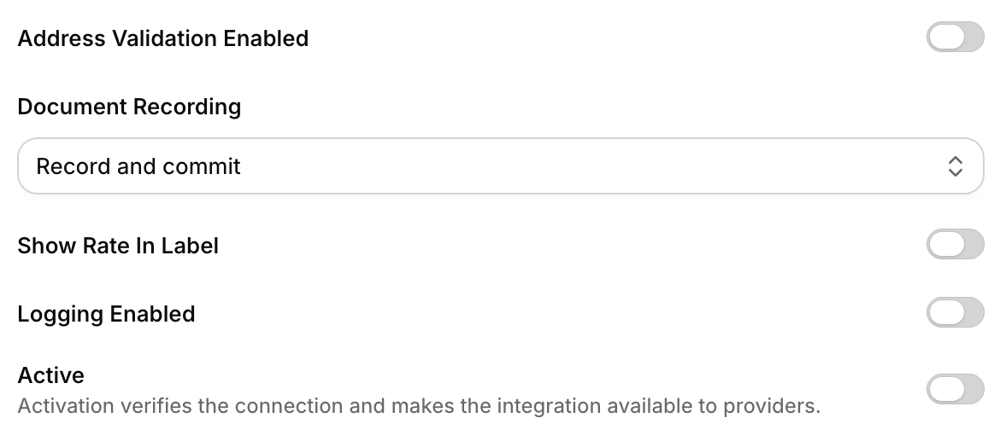
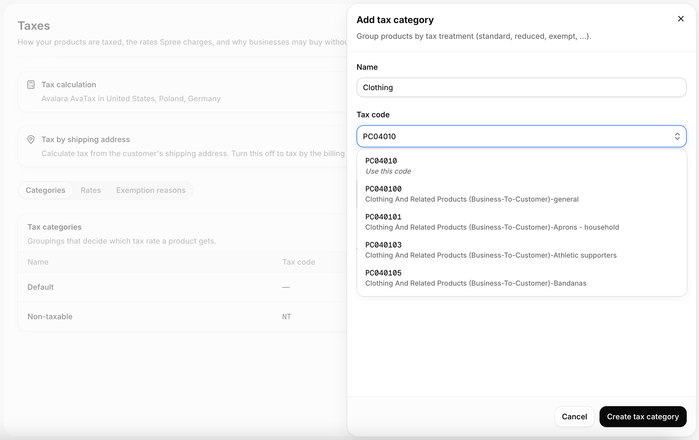
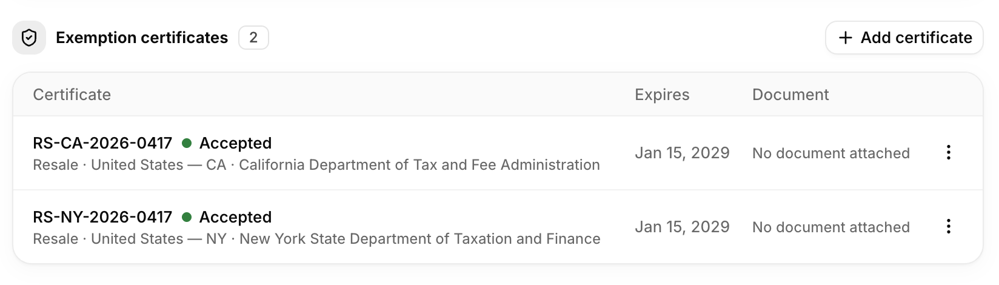
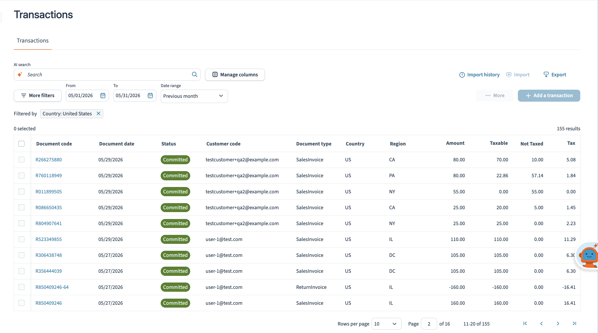

Avalara AvaTax works out sales tax, VAT and GST for each sale in real time. With the integration connected, Avalara calculates the tax on every line and delivery charge at checkout. Spree then files the placed order with Avalara, voids it if the order is cancelled, and files a credit when money goes back on a return, claim or exchange. It can also check US and Canadian addresses at checkout.

<Info>You need an Avalara account. Use a sandbox account to try the integration before going live.</Info>

## Installation

Add the gem to your Spree application and restart the server:

```bash
bundle add spree_avalara
```

The gem adds no database tables, so there are no migrations to run. If you are moving from the 5.x extension (`spree_avatax_official`), see [Upgrading from Spree 5](#upgrading-from-spree-5).

## Connect Avalara

In the Spree admin, go to **Settings → Integrations** and find the **Avalara AvaTax** tile.



Click **Connect** and fill in the form:

- **Account number** and **License key** — your AvaTax credentials, from your Avalara account.
- **Company code** — the company in your Avalara account that orders are filed against.
- **Environment** — **Sandbox** for testing (the default) or **Production** for your live store. It must match the account the credentials belong to.



When you save, Spree tests the connection. It checks that the credentials are accepted and that your Avalara account holds the company code you entered. If either check fails, the integration stays off and the form tells you which: Avalara's own message for rejected credentials, or **Company code … was not found in this Avalara account** for a mistyped code.

### Settings

These settings are on the same form.



- **Document recording** — what happens to a placed order at Avalara:
  - **Record and commit** (the default) files it as committed, so it appears in your Avalara reports and returns.
  - **Record without committing** files it as saved. It stays out of your returns until you commit it in Avalara.
  - **Don't record** files nothing. Spree still asks Avalara for the tax at checkout, but no order, cancellation or credit is sent. Choose this when another system, such as your ERP, records your sales with Avalara. Switching to it also stops cancellations and credits for orders recorded before the switch.
- **Address validation** — when on, a checkout whose US or Canadian address Avalara cannot verify is refused before the order is placed.
- **Logging** — when on, every call to Avalara is written to your application's log. See [Logging](#logging).

## Choose where Avalara calculates tax

Each [<u>market</u>](/user/settings/markets) chooses who calculates its tax. Set a market's tax calculation to **Avalara AvaTax** and every sale in it is taxed by Avalara. Markets you leave alone keep using Spree's own tax rates, so you can move one region at a time.

Avalara taxes a sale from where it ships to where it goes, so **your stock locations need full addresses**: street, city, state or region and postal code. Set them at **Settings → Locations**. An order shipped from several locations is taxed and reported per location.

## Tax codes

Each line is sent with an Avalara tax code, which tells Avalara what is being sold. Set the codes on your tax categories at **Settings → Taxes → Tax categories**.

When a market calculates through Avalara, the **Tax code** field searches Avalara's codes as you type. Type a word such as `clothing`, or the start of a code such as `PC04`, and pick a code from the list. You can still type a code that is not listed.



- A product is sent with its tax category's code. A product without one uses the store's default tax category, and then Avalara's general tangible goods code, `P0000000`.
- A delivery is sent as its own line with the code of its delivery method's tax category, or Avalara's freight code, `FR`, when it has none. Set delivery methods' tax categories at **Settings → Shipping**.

You can also browse every code at [taxcode.avatax.avalara.com](https://taxcode.avatax.avalara.com/).

## Customers and exemptions

Avalara keys each sale to a customer code: the customer's ID, or the email address for a guest. Exemption certificates recorded in Avalara for that customer code are applied by Avalara automatically.

For business buyers, record exemptions in Spree on the company. Open the company at **Customers → Companies** and add its certificates on the **Exemption certificates** card. Each certificate names its states or countries, its certificate number and an exemption reason.



Avalara decides an exemption by its entity use code, so give each exemption reason the matching Avalara code at **Settings → Taxes → Exemption reasons** (`G` for resale, `A` for federal government, and so on). Once a market uses Avalara, the reason form offers Avalara's codes. A reason with a code Avalara does not define is sent as `L` (other).

A company's tax registration (its VAT number) is set on its **Tax registration** card and sent with each sale, so Avalara can zero-rate an intra-EU business sale or apply reverse charge.

See [<u>Companies</u>](/user/customers/companies) and [<u>Taxes</u>](/user/settings/taxes) for how to manage these.

## What Spree sends to Avalara

| When | What Spree files | Document code |
|---|---|---|
| An order is placed | A sales invoice | The order number |
| An order is cancelled | A void of that sales invoice | The order number |
| Money goes back on a return or claim | A return invoice crediting the lines and the tax the customer was refunded | The order number and the return or claim number, such as `R123456789-RET1001` |
| An exchange is fulfilled | A return invoice for what came back, and a sales invoice for the replacement | The order and exchange numbers, with `-REPLACEMENT` on the sale |

Each document carries the customer code, the ship-from, ship-to and bill-to addresses, the location it ships from as the reporting location (from the location's admin name), and the order's purchase order number when it has one. A credit is dated the day the money went back but taxed as of the original sale, and carries exactly the tax the customer was refunded.

With **Don't record** chosen, none of these documents is sent.



## Logging

Turn on **Logging** to trace what Spree sends to Avalara. Each call writes one line to your application's log, tagged `[AVATAX]`, with the operation, the HTTP status (or the network error), how long the call took, and the request and response. Your credentials are never logged.

The requests contain customer addresses, and a guest's email address is their customer code, so turn logging on while you need it and keep the log under your usual retention.

## Upgrading from Spree 5

If your store used the 5.x extension, `spree_avatax_official`, run the upgrade task once after installing the gem:

```bash
bin/rails spree_avalara:upgrade
```

It keeps your credentials and settings (a commit setting that was off becomes **Record without committing**), turns customers' VAT numbers into tax registrations, removes the tax rate the old extension created, points markets that named no tax calculation at Avalara, and adds an exemption reason for each Avalara entity use code. It can be run again safely.

The old extension's schema stays in place until you remove it:

```bash
bin/rails spree_avalara:upgrade:drop_legacy_schema
```

## Managing your integration

You can change the credentials and settings at any time from **Settings → Integrations**.

<Warning>Turning the integration off does not break checkout, but markets that calculate through Avalara then charge no tax at all until it is reconnected. The misconfiguration is reported to your error tracker. Point those markets at Spree's own tax rates if Avalara will be off for long. Orders already filed with Avalara are not affected.</Warning>
