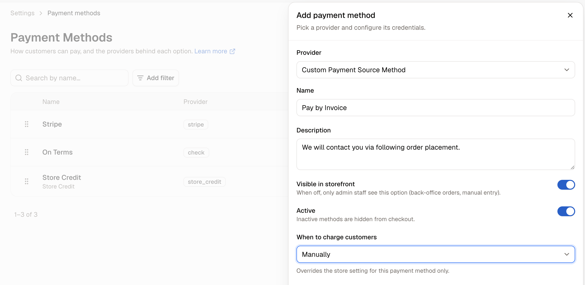
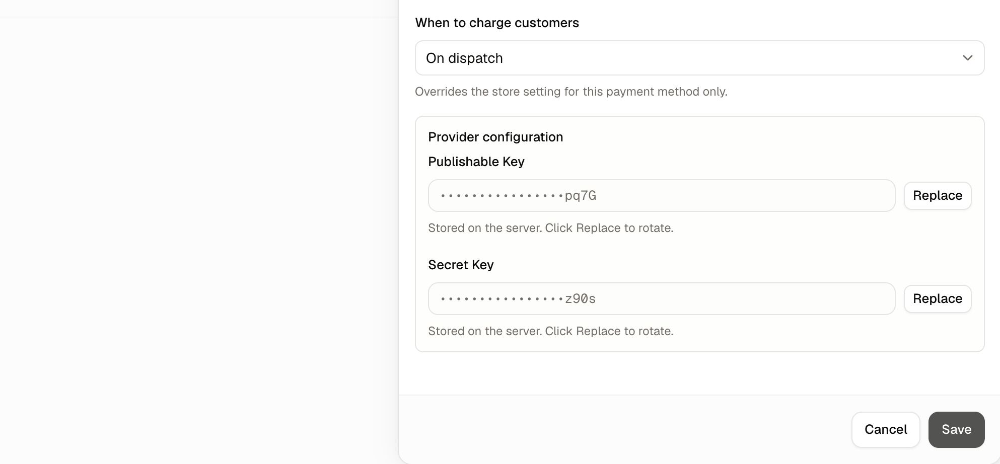

A payment method is a way for a customer to pay, and the provider that handles it. Most stores need more than one, because different customers pay differently and not every method suits every order.

A typical setup might pair a card gateway for everyday retail with one or two methods your team uses on back-office orders. A business customer placing a large order may need to pay on invoice rather than by card, and a shop with a counter may take payment in person. Each of those is its own payment method, and each can be shown to customers or kept for staff only.

To manage them, navigate to **Settings → Payments**, under the **Selling** group.

<Note>Stripe is included with Spree out of the box, so you can take card payments by connecting an account rather than installing anything first.</Note>

## Reviewing Your Payments

The page has three sections:

- **Payment providers** - Outside providers that process cards and wallets, such as Stripe. Each has a card with its logo and status: **Active**, **Disabled** or **Not connected**. The switch on a card turns a connected provider on or off.
- **Manual payment methods** - Methods your store handles itself, such as Check and Store Credit. Each row shows the method's name, its description, and badges for its status and for **Admin only** methods.
- **Payment capture** - When customers are charged, for every method that doesn't set its own. See [When to Charge Customers](#when-to-charge-customers) below.

## Ordering Methods at Checkout

Click **Checkout order** at the top of the page. A panel lists the methods customers can choose at checkout, which are the active ones visible on the storefront, in the order checkout shows them. Drag a method by its handle to move it, and put your most-used method at the top. Each move saves straight away.

Providers and manual methods share one order, so a manual method can come before a provider.

## How to Add a Payment Method

To connect an outside provider, click **Connect** on its card under **Payment providers**. A panel opens with that provider already chosen.

To add a method your store handles itself, click **Add manual method** under **Manual payment methods**, then choose its type.

### Choosing a provider

The provider decides what actually processes the payment, and which settings appear afterwards. There are two kinds.

**Payment providers**, such as Stripe, connect to an outside payment processor. They need credentials from that provider, which you enter in the same panel while creating the method.

**Manual payment methods** need no credentials because nothing is being processed elsewhere:

- **Check** - Records that a customer will pay by cheque or bank transfer. The order is created and your team marks it paid when the money arrives.
- **Store Credit** - Lets customers pay with credit already on their account.
- **Custom Payment Source Method** - A generic method for payment arrangements handled outside Spree, such as an account customer paying on invoice.

**Bogus** is a test provider that simulates payments without moving money. It appears under **Payment providers**. Use it to try a checkout end to end, and keep it **Admin only** so customers never see it.

### Provider configuration

Third-party providers need credentials before they will work. The fields differ by provider, and they appear in the panel as soon as you choose one.

Enter the keys from your provider's own dashboard. Stored credentials are not shown back to you afterwards, and each has a **Replace** button for rotating a key later.

Manual methods have no configuration section, because nothing is being processed elsewhere.

### Naming and visibility

These settings decide how a method is displayed:

- **Name** - What customers see at checkout, such as "Credit card" or "Pay by invoice".
- **Description** - The customer-facing description shown at checkout, useful for explaining what happens next on anything other than a card payment.
- **Visible on storefront** - On by default. When off, only staff see this option, which is what you want for methods used on back-office orders and manual entry.
- **Active** - On by default. Inactive methods are hidden from checkout entirely.

<Note>**Visible on storefront** and **Active** do different jobs. Turning off **Visible on storefront** keeps a method available to your team; turning off **Active** withdraws it from everyone.</Note>

### When to charge customers

This decides the moment a customer's money actually moves. Set the store default under **Payment capture** on the Payments page, and click **Save** to apply it. Every method follows that default unless you override it in its own panel.

| Option | What happens |
|---|---|
| **Use the store setting** | Only on a single method. Follows the store default, with the inherited value named in brackets. |
| **At checkout** | Takes the money as soon as the order is placed. |
| **On dispatch** | Reserves the amount at checkout and takes it when the goods go out. |
| **Manually** | Reserves the amount at checkout and lets staff take it later. |

Which one suits depends on how quickly you fulfil:

**At checkout** is the simplest and suits stores shipping in-stock goods promptly. The money is in before you pack, and reconciliation is straightforward because every order has a payment against it.

**On dispatch** suits made-to-order goods, pre-orders and anything with a wait, where charging weeks before a customer receives anything invites complaints and refunds. The amount is reserved at checkout so you know the card is good, and taken when the parcel leaves.

**Manually** suits orders that need a person to decide, such as a business order awaiting approval, a quote being finalised, or an order shipping in parts. Staff take the payment when they are ready.

<Warning>Reserved amounts do not hold indefinitely. Card authorisations expire after a period set by the card network, so **On dispatch** and **Manually** need the order fulfilled or the payment taken within that window, or the reservation lapses and has to be retaken.</Warning>

### Checkout conditions

Conditions decide when customers are offered a method at checkout. A method with no conditions is offered at every checkout. Add one with **Add condition**:

| Condition | Offers the method only… |
|---|---|
| **Channel** | On the sales channels you pick, such as invoice payment on the wholesale storefront only. |
| **Market** | In the markets you pick. |
| **Order total** | When the order total is within a minimum and maximum, set separately for each currency. A currency left blank is not limited. |
| **Customer group** | To signed-in customers in the groups you pick. Guests never see it. |
| **Company** | To orders placed for a company. Pick companies to narrow it to those companies and their divisions. |

Every active condition must be met for the method to appear. Turn a condition's switch off to pause it without losing its settings.

<Note>Conditions apply to customers checking out on your storefront. Your team can still record any active method against an order in the dashboard.</Note>

### Running two accounts with one provider

You can add the same provider more than once, for example a Stripe account for Europe and another for the United States. Once a provider is connected, click **Add account** under **Payment providers** and choose it again. The provider list shows how many of each you already have. Give each method a **Market** condition with its own markets, and make sure no market is in both. A market listed in both would show customers two identical options at checkout.

<Warning>If your marketplace pays sellers through Stripe Connect, only one Stripe method can be active at a time.</Warning>

Click **Create payment method** when you are done.

## How to Edit a Payment Method

Click **Configure** on a provider's card, or click a manual method's row, to update the name, description, visibility, status, credentials or checkout conditions. The edit panel shows the provider in its subtitle rather than as a dropdown.

The provider cannot be changed once a method exists. If you need a different provider, create a new method and disable the old one.

<Warning>Test a new payment method with a real checkout before making it visible to customers. A method with wrong credentials still appears at checkout and fails when a customer tries to use it.</Warning>

## How to Delete a Payment Method

Open the method's panel and click **Delete**. Spree confirms that the method will no longer be available at checkout.

<Note>Disabling a method is usually better than deleting it. Turning **Active** off withdraws it from checkout while keeping it attached to the orders that used it.</Note>

## Further Reading

- [<u>Taxes</u>](/user/settings/taxes) - Whether tax follows the shipping or the billing address
- [<u>Processing Orders</u>](/user/orders/processing-orders) - Taking a payment that was reserved rather than captured
- [<u>Issue Store Credits</u>](/user/loyalty/store-credits) - Adding credit that the Store Credit method can spend
